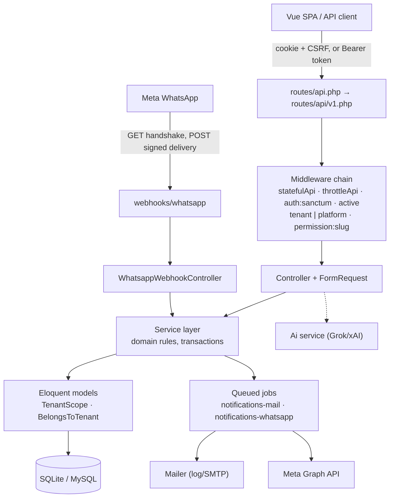
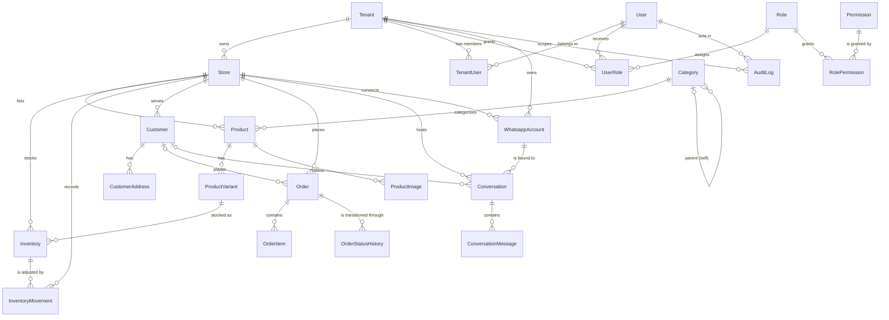

# Dukavo Backend

The Laravel API behind **Dukavo**, a multi-tenant commerce platform for
merchants who sell and support customers over WhatsApp.

This repository owns everything server-side: authentication, tenant and store
isolation, custom role-based access control, the merchant catalogue/inventory/
order domain, the WhatsApp Cloud API integration (sending, webhook handshake and
inbound processing), background notifications, platform administration and the
marketing site's public API.

The companion single-page application lives in the sibling `frontend/`
repository and talks to this API over a versioned JSON surface under `/api/v1`.

---

## Contents

1. [Key features](#1-key-features)
2. [Technology stack](#2-technology-stack)
3. [Architecture overview](#3-architecture-overview)
4. [Prerequisites](#4-prerequisites)
5. [Local setup](#5-local-setup)
6. [Environment variables](#6-environment-variables)
7. [API reference](#7-api-reference)
8. [Authentication and authorization](#8-authentication-and-authorization)
9. [Database overview](#9-database-overview)
10. [Integrations](#10-integrations)
11. [Testing and quality checks](#11-testing-and-quality-checks)
12. [Troubleshooting](#12-troubleshooting)
13. [Security](#13-security)
14. [Production deployment checklist](#14-production-deployment-checklist)
15. [Contributing](#15-contributing)
16. [License](#16-license)

---

## 1. Key features

Everything below is implemented and covered by the test suite unless noted
otherwise.

- **Authentication** — login, logout, forgot/reset password, email
  verification and password confirmation through Laravel Fortify, with
  Sanctum bearer tokens and stateful (cookie) sessions for the SPA.
- **Multi-tenancy** — a tenant header (`X-Tenant`) selects the workspace; the
  active tenant is resolved from the caller's own memberships, never from
  request input, and a global model scope keeps every query inside the tenant.
- **Store isolation** — each tenant owns one or more stores; products,
  inventory, customers, orders and conversations are store-scoped rows.
- **Custom RBAC** — a hand-built permission catalogue
  (`App\Support\PermissionRegistry`, 32 slugs across 14 modules), custom roles
  per scope, a `permission:<slug>` route middleware, and seeded platform and
  tenant roles. Spatie Permission is **not** used.
- **Catalogue** — categories (hierarchical, slug-addressed), products with
  variants and a reorderable image gallery, slug-availability checks.
- **Inventory** — stock per store/product variant with an append-only movement
  ledger, low-stock reporting, adjust and receive actions.
- **Customers and orders** — customers with addresses, orders with human
  order numbers (`ORD-000123`), server-recomputed totals, status transitions
  and per-order status history.
- **Conversations (inbox)** — channel-agnostic threads with search, status and
  owner filters, unread state, assignment, private internal notes, approved
  WhatsApp templates, the 24-hour reply window, failed-message retry, safe
  authenticated media, a summary endpoint and outbound replies; inbound
  WhatsApp threads are bound to the number they arrived on.
- **WhatsApp Cloud API** — connect/verify/disconnect numbers per tenant,
  outbound text and template sending through Meta's Graph API, Meta's GET
  verification handshake, and signed inbound webhooks (delivery receipts and
  customer messages).
- **Notifications** — a dispatch pipeline with event keys (idempotency),
  per-user preferences, an in-app bell, queued email delivery and a
  WhatsApp channel that is configuration-ready but disabled by default.
- **AI assistance (Grok/xAI)** — reply drafts, tenant and platform insights and
  newsletter content generation behind an `ai.use` permission, per-user and
  per-tenant daily caps, and an append-only usage ledger. Disabled with a `503`
  when no API key is configured.
- **Platform administration** — tenant lifecycle (create, suspend, activate,
  delete), platform staff accounts and roles, audit log, and Dukavo's own
  marketing content: pricing plans, FAQ, content pages, newsletters, waitlist
  and contact inboxes.
- **Public/marketing API** — pricing, FAQ, features, content pages, newsletter
  archive and throttled lead-capture forms with a honeypot field.
- **Audit log** — platform and tenant activity recorded with actor, action and
  payload, readable through permission-gated endpoints.

### Explicitly not implemented

These are deliberate, documented gaps — do not assume they exist:

- **Self-service registration.** `Features::registration()` is disabled in
  [`config/fortify.php`](config/fortify.php); there is no
  `POST /api/v1/auth/register` route, and a test asserts it stays unroutable.
  Accounts are created by platform operators (or seeded).
- **Payments / paid subscriptions.** `config/dukavo.php` states that no
  payment provider has been selected. `pricing_plans` are display records; the
  platform dashboard reports no billing figures.
- **WhatsApp as a notification channel.** The transport exists but is off by
  default (`DUKAVO_NOTIFICATION_WHATSAPP=false`); deliveries are recorded as
  skipped rather than faked.

---

## 2. Technology stack

| Layer | Choice | Evidence |
| --- | --- | --- |
| Language | PHP `^8.3` (workspace runtime: PHP 8.5) | `composer.json` |
| Framework | Laravel `^13.17` (locked: 13.34.0) | `composer.lock` |
| Authentication | Laravel Fortify `^1.40` + Laravel Sanctum `^4.0` (4.3.3) | `composer.json` |
| Authorization | Custom RBAC (`App\Support\PermissionRegistry`) | no Spatie dependency |
| Database | SQLite by default (`DB_CONNECTION=sqlite`); MySQL config present | `.env.example`, `config/database.php` |
| Session / cache / queue | All `database` by default; failed jobs on `database-uuids` | `.env.example`, `config/queue.php` |
| Mail | `symfony/mailer`; default mailer is `log` | `config/mail.php` |
| HTTP client | Guzzle 8.2 (Graph API, xAI) | `composer.lock` |
| WhatsApp | Meta Graph API v26.0 (configurable) | `config/services.php` |
| AI | Grok / xAI Responses API | `config/ai.php` |
| Tests | PHPUnit `^12.5` (12.5.37) — **not** Pest | `composer.json` |
| Style | Laravel Pint (default preset, no `pint.json`) | `composer.json` |
| Frontend asset build | Vite 8 + Tailwind 4 (`resources/`, welcome page only) | `package.json` |

Not present in this repository: Docker/Compose files, CI workflows, static
analysis (PHPStan/Psalm), Redis (config exists but the driver is not the
default), and any payment SDK.

---

## 3. Architecture overview

### Request flow



### Layers and boundaries

- **Routes** declare access, not controllers: every endpoint's tier
  (public / platform / tenant) and its `permission:<slug>` are visible in
  [`routes/api/v1.php`](routes/api/v1.php), so the permission requirement of
  the whole API is reviewable in one file.
- **Controllers** are thin: they authorize, validate through `FormRequest`
  classes (`app/Http/Requests`), delegate to a service, and respond through
  `App\Support\ApiResponse` or an Eloquent resource (`app/Http/Resources`).
- **Services** (`app/Services/*`) hold domain rules and multi-model
  transactions: catalogue, inventory, orders, conversations, RBAC, tenancy,
  notifications, audit, WhatsApp, AI.
- **Models** carry tenancy: `BelongsToTenant` stamps `tenant_id` on create and
  `TenantScope` filters every read. `TenantContext` (a singleton) holds the
  active tenant for the request and is set only by middleware — or explicitly
  via `run()` from seeders, tests and queue jobs.
- **Support** holds cross-cutting primitives: `ApiResponse`, `PermissionRegistry`,
  `HtmlSanitizer`, `TenantContext`, device naming for login tokens.

### Middleware

| Alias | Class | Responsibility |
| --- | --- | --- |
| `tenant` | `ResolveTenant` | Resolves `X-Tenant` (slug or id) against the caller's memberships; rejects suspended tenants; never reads `tenant_id` from body/query; runs before route-model binding. |
| `tenant.optional` | `ResolveOptionalTenant` | Same, but tolerates having no tenant (profile, `GET /me`). |
| `platform` | `EnsurePlatformAccess` | Platform operators only. |
| `permission` | `EnsurePermission` | Any-of `permission:<slug>` checks against the resolved tenant (or platform roles when no tenant). |
| `active` | `EnsureUserIsActive` | Re-reads user status from the database; a suspended account's tokens are revoked immediately. |

Applied globally in `bootstrap/app.php`: `statefulApi()` (Sanctum stateful
middleware for the SPA), `throttleApi('api')`, and `redirectGuestsTo(null)` so
unauthenticated API requests get JSON `401` instead of a login redirect.

### Response envelope and status codes

Single resources and actions return one shape through `App\Support\ApiResponse`:

```json
{ "success": true, "message": "Role created.", "data": { "id": 5 } }
{ "success": false, "message": "…", "errors": { "email": ["…"] } }
```

Collection endpoints return Laravel's resource wrapper —
`{ "data": [...], "links": {…}, "meta": {…} }` — with `success` added.
Pagination `meta`/`links` follow Laravel's default page paginator.

| Status | Meaning |
| --- | --- |
| `401` | Missing or invalid credentials (also on session expiry) |
| `403` | Authenticated but not allowed (permission, platform or tenant boundary) |
| `404` | Not found — including rows that exist in another tenant |
| `409` | Domain-rule refusal (`BusinessRuleViolation`) — the current state does not permit the change |
| `422` | Validation failure |
| `429` | Throttled (login, waitlist, contact, newsletter, global API limiter) |
| `500` | Unexpected failure; message only, details when `APP_DEBUG=true` |

> Domain-rule refusals such as replying outside the WhatsApp window, assigning
> to an ineligible user, or retrying a message that cannot be retried render as
> **`409`** with the standard `success: false` envelope and the reason in
> `message`.

Exception rendering for 401/403/404/409/422/429/500 lives centrally in
`bootstrap/app.php`, so every failure returns the same `success: false`
envelope.

### Background work

Two queued jobs — `SendNotificationEmail` and `SendNotificationWhatsApp` — run
on the `database` queue (`notifications-mail` / `notifications-whatsapp`
queues). There are no custom event/listener classes; background work is
dispatched as jobs from the notification dispatcher. Jobs receive ids only,
re-read their row, and guard against duplicate terminal states.

---

## 4. Prerequisites

| Requirement | Notes |
| --- | --- |
| PHP `^8.3` | Required by `composer.json`. Developed and tested on PHP 8.5. |
| Composer 2 | Dependency installation. |
| SQLite | Zero-config default (`database/database.sqlite`). MySQL is supported through `config/database.php` if you prefer. |
| Node.js + npm | Only for the optional backend asset build and for running the companion `frontend/` app. |
| A Meta WhatsApp account | Only if you want to exercise the WhatsApp integration for real; everything else runs without it. |

---

## 5. Local setup

```bash
git clone <backend-repository> backend   # or copy the directory
cd backend
composer install
cp .env.example .env
php artisan key:generate
touch database/database.sqlite           # DB_CONNECTION=sqlite is the default
php artisan migrate --seed               # demo data — see the warning below
php artisan storage:link                 # public disk (avatars, product images)
php artisan serve                        # http://127.0.0.1:8000
```

In a second terminal, start a queue worker — notification emails are queued
and will not send without it:

```bash
php artisan queue:work
```

`php artisan dev` (or `composer run dev`) runs the dev processes Laravel
registers — server, queue worker and log tail — together.

**What `migrate --seed` does.** `DatabaseSeeder` loads roles and permissions,
two platform users, four demo tenants with staff, a full catalogue, inventory,
customers, orders, conversations, audit history and marketing content. It is a
**demo dataset**, deterministic by design, and it is meant for local
development. Do not run it against a production database.

**Seeded logins** (all use the password `password` — development only):

| Email | Role | Scope |
| --- | --- | --- |
| `admin@gmail.com` | `super-admin` | platform |
| `support@dukavo.test` | `dukavo-admin` | platform |
| `claire@urban-basket.test` | `merchant` | tenant `urban-basket` |
| `marcus@urban-basket.test` | `staff` | tenant `urban-basket` |

Three further demo tenants (`nour-market`, `gaza-fresh`, `daily-needs`) each
ship with their own merchant and staff users — see
`database/seeders/Support/DemoPeople.php`.

**Alternative:** `composer setup` runs `composer install`, copies `.env` if
missing, generates the key, runs `migrate --force`, then installs and builds
the backend assets. It does **not** seed.

**Frontend:** the SPA runs separately — see `../frontend/README.md`. During
local development it proxies `/api` and `/sanctum` to `http://127.0.0.1:8000`,
so no CORS configuration is exercised until you point it at an absolute URL.

---

## 6. Environment variables

Copy [`.env.example`](.env.example) to `.env`. Values below are placeholders —
never commit a filled-in `.env` (it is git-ignored).

### Application (required)

| Variable | Purpose | Safe default |
| --- | --- | --- |
| `APP_KEY` | Encryption key — empty until `php artisan key:generate` | generate it |
| `APP_ENV` / `APP_DEBUG` | Environment; debug detail in responses | `local` / `true` |
| `APP_URL` | Absolute base URL of this API | `http://localhost:8000` |
| `APP_LOCALE` | Default locale (`en`, `ar` supported) | `en` |

### Database, session, cache, queue (required as shipped)

| Variable | Purpose | Default |
| --- | --- | --- |
| `DB_CONNECTION` | `sqlite` (default) or a MySQL connection | `sqlite` |
| `DB_HOST` `DB_PORT` `DB_DATABASE` `DB_USERNAME` `DB_PASSWORD` | MySQL credentials — uncomment and fill when using MySQL | commented out |
| `SESSION_DRIVER` | `database` (used by the SPA cookie flow) | `database` |
| `SESSION_LIFETIME` | Minutes | `120` |
| `CACHE_STORE` | `database` | `database` |
| `QUEUE_CONNECTION` | `database` — run `php artisan queue:work` | `database` |
| `QUEUE_FAILED_DRIVER` | Failed-job storage driver | `database-uuids` (code default) |

### SPA and CORS (required for the Vue client)

| Variable | Purpose | Default |
| --- | --- | --- |
| `FRONTEND_URL` | Allowed CORS origin for the SPA | `http://localhost:5173` |
| `SANCTUM_STATEFUL_DOMAINS` | Domains allowed to use stateful (cookie) auth | `localhost:5173,127.0.0.1:5173,localhost:8000,127.0.0.1:8000` |
| `VITE_APP_NAME` | Name exposed to the built asset | `${APP_NAME}` |

### Mail (optional for local work)

| Variable | Purpose | Default |
| --- | --- | --- |
| `MAIL_MAILER` | `log` writes messages to `storage/logs` instead of sending | `log` |
| `MAIL_FROM_ADDRESS` / `MAIL_FROM_NAME` | Outgoing sender | `hello@example.com` |

### WhatsApp Cloud API (optional — required for real messaging)

| Variable | Purpose | Required when |
| --- | --- | --- |
| `WHATSAPP_CLOUD_API_VERSION` | Graph API version | default `v26.0` |
| `WHATSAPP_CLOUD_API_TOKEN` | Permanent/system-user access token; **server-side only** | sending messages |
| `WHATSAPP_PHONE_NUMBER_ID` | Sending number id (Meta dashboard) | sending, inbound binding |
| `WHATSAPP_BUSINESS_ACCOUNT_ID` | WhatsApp Business Account id | account verification |
| `WHATSAPP_WEBHOOK_VERIFY_TOKEN` | Secret you invent and enter in Meta's webhook config | webhook handshake |
| `WHATSAPP_APP_SECRET` | Meta App Secret — validates `X-Hub-Signature-256` | **inbound webhooks: refused while empty** |
| `WHATSAPP_API_BASE_URL` | Graph API host | default `https://graph.facebook.com` |
| `WHATSAPP_MESSAGING_WINDOW_HOURS` | Free-form reply window after the customer's last message | `24` |
| `WHATSAPP_MEDIA_MAX_BYTES` | Maximum inbound attachment size accepted for storage | `26214400` (25 MB) |
| `WHATSAPP_MEDIA_HOSTS` | Comma-separated HTTPS host allowlist for provider media downloads; `*.example.com` matches subdomains | `lookaside.fbsbx.com,*.fbcdn.net,*.whatsapp.net` |

Details in [Integrations](#10-integrations).

### AI — Grok/xAI (optional)

| Variable | Purpose | Default |
| --- | --- | --- |
| `GROK_API_KEY` | API key; **server-side only**. Without it every AI endpoint answers `503` and nothing else is affected. | empty (AI off) |
| `GROK_MODEL` | Model name | `grok-4.7` |
| `GROK_BASE_URL` | Provider base URL | `https://api.x.ai/v1` |
| `AI_ENABLED`, `AI_TIMEOUT`, `AI_RATE_PER_MINUTE`, … | Fine-grained overrides (feature toggles, caps, retries) — all documented in [`config/ai.php`](config/ai.php) | commented out |

### Notifications (optional)

| Variable | Purpose | Default |
| --- | --- | --- |
| `DUKAVO_NOTIFICATION_MAIL` | Email channel | `true` |
| `DUKAVO_NOTIFICATION_WHATSAPP` | WhatsApp channel | `false` |
| `DUKAVO_NOTIFICATION_WHATSAPP_TEMPLATE` | Approved Meta template name | empty |
| `DUKAVO_NOTIFICATION_WHATSAPP_LANGUAGE` | Template language | `en` |
| `DUKAVO_NOTIFICATION_REQUIRE_VERIFIED_EMAIL` | Skip mail for unverified users | `true` |
| `DUKAVO_NOTIFICATION_RETRY_TIMES` | Job attempts | `3` |
| `DUKAVO_CONTACT_EMAIL` | Contact-form recipient; falls back to `MAIL_FROM_ADDRESS` | empty |

### Platform tuning (optional, code defaults)

`DUKAVO_NAME`, `DUKAVO_TENANT_HEADER` (`X-Tenant`), `DUKAVO_API_RATE_LIMIT`
(120/min), `DUKAVO_WRITE_RATE_LIMIT` (30/min), `DUKAVO_ORDER_PREFIX` (`ORD`),
`DUKAVO_BILLING_PROVIDER`, `DUKAVO_BILLING_CHECKOUT` (`false` — checkout is
not implemented). See [`config/dukavo.php`](config/dukavo.php).

### Unused by default

`config/services.php` also reads `POSTMARK_API_KEY`, `RESEND_API_KEY`,
`AWS_*` and `SLACK_*`. They are not in `.env.example` and are not required;
the default mailer is `log` and the default filesystem disk is `local`.

---

## 7. API reference

**Base URL:** `http://127.0.0.1:8000/api` — versioned surface under `/api/v1`.
**183 routes total, 176 of them under `/api/v1`** (`php artisan route:list`).

Send `Accept: application/json` on every request. Authenticate either with a
Sanctum **bearer token** from login, or with the SPA **cookie flow**:
`GET /api/tenant/../` needs `GET /sanctum/csrf-cookie` first, then the
`X-XSRF-TOKEN` header. Tenant routes additionally require:

```http
X-Tenant: urban-basket
```

### Health

| Method | Path | Notes |
| --- | --- | --- |
| `GET` | `/api/health` | Public; returns status, app name, Laravel and PHP versions, environment, timestamp |
| `GET` | `/up` | Framework liveness probe |

### Authentication (`/api/v1/auth`)

Fortify's routes are loaded manually under this prefix
([`routes/api/v1.php`](routes/api/v1.php)).

| Method | Path | Purpose |
| --- | --- | --- |
| `POST` | `/auth/login` | Sign in (throttled). Returns `{ success, data: { user, token, token_type } }` |
| `POST` | `/auth/logout` | Revoke the current token and end the session |
| `POST` | `/auth/forgot-password` | Request a reset link |
| `POST` | `/auth/reset-password` | Reset with a token |
| `PUT` | `/auth/user/password` | Change own password (confirmed password required) |
| `POST` | `/auth/user/confirm-password` | Confirm the password for sensitive flows |
| `GET` | `/auth/user/confirmed-password-status` | Whether the password is currently confirmed |
| `POST` | `/auth/email/verification-notification` | Resend the verification mail (throttled) |
| `GET` | `/auth/email/verify/{id}/{hash}` | Verify an email address |

> There is **no** registration endpoint (see
> [Explicitly not implemented](#explicitly-not-implemented)).

```http
POST /api/v1/auth/login
{ "email": "claire@urban-basket.test", "password": "password" }

200 { "success": true, "message": "Signed in.",
      "data": { "user": { "id": 4, "name": "…", "email": "…" },
                "token": "1|…", "token_type": "Bearer" } }
```

### Account context (authenticated, no tenant required)

| Method | Path | Purpose |
| --- | --- | --- |
| `GET` | `/me` | Boot payload: user, tenants, roles and effective permissions (`tenant.optional`) |
| `GET` | `/permissions` | The permission catalogue |
| `POST` | `/onboarding/tenant` | Create the caller's first workspace (caller becomes owner) |
| `GET` `PATCH` | `/profile` | Read / update own profile |
| `POST` `DELETE` | `/profile/avatar` | Upload / remove the avatar |
| `PUT` | `/profile/password` | Change own password |
| `GET` `DELETE` | `/profile/sessions` | List other devices / sign them all out |
| `DELETE` | `/profile/sessions/{token}` | Sign out one device |
| `GET` `PUT` | `/profile/notifications` | Notification preferences |
| `GET` | `/profile/notifications/channels` | Channel availability + reasons |

### Notification centre (per user, not per tenant)

| Method | Path | Purpose |
| --- | --- | --- |
| `GET` | `/notifications` | Paginated inbox |
| `GET` | `/notifications/unread-count` | Badge count |
| `POST` | `/notifications/read-all` | Mark everything read |
| `POST` | `/notifications/{notification}/read` | Mark one read |
| `DELETE` | `/notifications/{notification}` | Dismiss |

### Public marketing (`/api/v1/public`, unauthenticated)

Writes carry named per-IP throttles (`waitlist` 5/min, `contact` 3/min,
`newsletter` 5/min) and accept a `website` honeypot field that silently
discards bots.

| Method | Path | Purpose |
| --- | --- | --- |
| `GET` | `/public/features` | Feature list |
| `GET` | `/public/pricing` | Published pricing plans |
| `GET` | `/public/faq` | Published FAQ entries |
| `GET` | `/public/pages/{key}` | Legal/content page by key (404 if unpublished) |
| `GET` | `/public/newsletters` · `/public/newsletters/{slug}` | Newsletter archive |
| `POST` | `/public/waitlist` | `{ email, name?, business_type?, source? }` |
| `POST` | `/public/contact` | `{ name, email, subject, message }` |
| `POST` | `/public/newsletter/subscribe` · `/unsubscribe` | `{ email, source? }` |

### Platform administration (`/api/v1/platform`, `platform` middleware)

Reads across tenants and Dukavo's own tables; resolves no tenant context.

| Group | Endpoints | Permission |
| --- | --- | --- |
| Dashboard | `GET /platform/dashboard` | platform role only |
| AI | `GET /platform/ai/insights`, `POST /platform/ai/newsletter-content` | `ai.use` |
| Tenants | `GET/POST /platform/tenants`, `GET/PATCH/DELETE /platform/tenants/{tenant}`, `POST …/suspend`, `…/activate`, `GET …/members` | platform role only |
| Roles | `GET/POST /platform/roles`, `GET/PATCH/DELETE /platform/roles/{role}`, `PUT …/{role}/permissions` | `roles.view` / `roles.manage` |
| Users | `GET/POST /platform/users`, `GET/PATCH/DELETE /platform/users/{user}`, `POST`/`DELETE …/{user}/roles/{role}` | `users.view` / `users.manage` |
| Audit | `GET /platform/audit-logs`, `…/actions`, `…/{auditLog}` | `audit.view` |
| Pricing plans | `GET/POST`, `GET/PATCH/DELETE /platform/pricing-plans[/{id}]` | platform role only |
| FAQ entries | `GET/POST`, `GET/PATCH/DELETE /platform/faq-entries[/{id}]` | platform role only |
| Content pages | `GET /platform/content-pages`, `GET/PATCH …/{contentPage}` (no create/delete — pages are seeded) | platform role only |
| Newsletters | `GET/POST /platform/newsletters`, `GET …/slug-availability`, `GET/PATCH/DELETE …/{newsletter}` | platform role only |
| Waitlist / contacts / subscribers | `GET`, `PATCH`, `DELETE` for each inbox | platform role only |

The absence of `permission:` slugs on marketing content is deliberate: those
tables have no `tenant_id`, and adding a slug would auto-grant it to merchants.

### Tenant workspace (`/api/v1/tenant`, `tenant` middleware + permission)

Every route below runs inside the resolved tenant and additionally requires the
listed permission.

| Resource | Endpoints | Permissions |
| --- | --- | --- |
| Roles | `GET/POST /tenant/roles`, `GET/PATCH/DELETE /tenant/roles/{role}`, `PUT …/{role}/permissions`, `POST …/{role}/assign`, `POST …/{role}/revoke` | `roles.view`, `roles.manage` (`assign`/`revoke`: `users.manage`) |
| Users | `GET/POST /tenant/users`, `GET/PATCH/DELETE /tenant/users/{user}` | `users.view`, `users.manage` |
| Stores | `GET/POST /tenant/stores`, `GET/PATCH/DELETE …/{store}`, `POST …/{store}/default` | `stores.view`, `stores.manage` |
| Settings | `GET/PATCH /tenant/settings` | `settings.view`, `settings.manage` |
| Categories | `GET /tenant/categories`, `…/tree`, `…/slug-availability`, `POST`, `GET/PATCH/DELETE …/{category}` | `categories.view`, `categories.manage` |
| Products | `GET/POST /tenant/products`, `…/slug-availability`, `GET/PATCH/DELETE /tenant/products/{product:slug}` | `products.view`, `products.create`, `products.update`, `products.delete` |
| Product images | `POST …/{product:slug}/images`, `…/images/reorder`, `PATCH/DELETE …/images/{image}` | `products.update` |
| Inventory | `GET /tenant/inventory`, `…/low-stock`, `…/{inventory}/movements`, `POST …/adjust`, `POST …/receive` | `inventory.view`, `inventory.manage` |
| Customers | `GET/POST /tenant/customers`, `GET/PATCH/DELETE …/{customer}` | `customers.view`, `customers.create/update/delete` |
| Orders | `GET/POST /tenant/orders`, `GET …/{order:order_number}`, `GET …/{order}/transitions`, `PATCH/DELETE …/{order}`, `POST …/{order}/transition` | `orders.view`, `orders.create/update/delete` |
| Conversations | `GET /tenant/conversations`, `…/summary`, `…/assignees`, `GET/PATCH/DELETE …/{conversation}`, `GET/POST …/{conversation}/messages`, `POST …/notes`, `POST …/templates`, `POST …/messages/{message}/retry`, `GET …/messages/{message}/media`, `POST …/read`, `POST …/assign` | `conversations.view`, `conversations.reply`, `conversations.assign` |
| AI | `POST …/{conversation}/ai-reply-draft`, `GET /tenant/ai/insights` | `ai.use` + `conversations.view` / `dashboard.view` |
| WhatsApp | `GET/POST /tenant/whatsapp-accounts`, `GET …/configuration`, `GET/PATCH/DELETE …/{whatsappAccount}`, `POST …/verify`, `POST …/disconnect` | `whatsapp.view`, `whatsapp.manage` |
| Dashboard | `GET /tenant/dashboard`, `…/summary`, `…/revenue`, `…/top-products`, `…/dead-stock` | `dashboard.view` |
| Audit | `GET /tenant/audit-logs`, `…/actions`, `…/{auditLog}` | `audit.view` |

Route-model binding follows the merchant-facing URL: products by `slug`,
orders by `order_number` (mutations stay on the primary key), categories by
id. Cross-tenant rows surface as `404`, never as a leak.

### Webhooks (public, provider-facing)

| Method | Path | Purpose |
| --- | --- | --- |
| `GET` | `/api/v1/webhooks/whatsapp` | Meta's verification handshake — returns the plain-text challenge |
| `POST` | `/api/v1/webhooks/whatsapp` | Inbound messages and delivery receipts — signature required |

See [Integrations](#10-integrations).

---

## 8. Authentication and authorization

### Authentication

- **Sanctum** provides both credentials: a **bearer token** minted by
  `POST /auth/login` (returned once in `data.token`, named after the device so
  the security screen can list it), and a **stateful cookie session** for the
  SPA (`statefulApi()` + `GET /sanctum/csrf-cookie` + `X-XSRF-TOKEN`).
- **Fortify** implements login, password reset, password confirmation and
  email verification, loaded manually under `/api/v1/auth`. Registration is
  disabled in `config/fortify.php`.
- `Fortify::authenticateUsing` rejects inactive accounts at credential check;
  the `active` middleware re-verifies status on every authenticated request.
- Password rules: minimum 12 characters with symbols and a compromised-password
  check in production, minimum 8 locally.

### Authorization (custom RBAC — no Spatie)

- `App\Support\PermissionRegistry` is the single catalogue: **32 slugs in 14
  modules**, seeded into the `permissions` table and returned to the client by
  `GET /me`, so the UI can never drift from what the server enforces.

| Module | Slugs |
| --- | --- |
| `products` | `view` `create` `update` `delete` |
| `categories` | `view` `manage` |
| `inventory` | `view` `manage` |
| `orders` | `view` `create` `update` `delete` |
| `customers` | `view` `create` `update` `delete` |
| `conversations` | `view` `reply` `assign` |
| `whatsapp` | `view` `manage` |
| `stores` | `view` `manage` |
| `settings` | `view` `manage` |
| `users` | `view` `manage` |
| `roles` | `view` `manage` |
| `dashboard` | `view` |
| `audit` | `view` |
| `ai` | `use` |

- Enforcement is the `permission:<slug>` route middleware (any-of when a route
  lists several), evaluated by `PermissionService` against `TenantContext`.
  A `Gate::before` hook grants a `super-admin` everything.

**Seeded roles and their defaults:**

| Role | Scope | Default permissions |
| --- | --- | --- |
| `super-admin` | platform | all 32 slugs; bypasses checks via `Gate::before` |
| `dukavo-admin` | platform | `users.view/manage`, `roles.view/manage`, `stores.view/manage`, `audit.view`, `ai.use` |
| `merchant` | tenant | all 32 slugs |
| `staff` | tenant | 16: dashboard, products//categories/inventory view (+ `inventory.manage`), orders view/create/update, customers view/create/update, conversations view/reply, `whatsapp.view`, `stores.view`, `ai.use` |

Custom roles may hold any subset of slugs within their scope. Platform roles
can only be managed by platform operators; system roles (`merchant`,
`staff`) refuse permission changes; a tenant role can only be assigned to a
tenant member — each of those refusals is a tested `403`/`422`.

### Tenancy and store isolation

1. The client sends `X-Tenant: <slug>` on tenant requests.
2. `ResolveTenant` resolves it **only** if the authenticated user holds a
   membership/role there, falls back to the user's sole tenant when the header
   is absent, and rejects suspended tenants. `tenant_id` in a body or query
   string is never trusted.
3. `TenantContext` is populated; `TenantScope` applies
   `where tenant_id = ?` to every query of a tenant model (it fails closed:
   without a context, tenant models match nothing), and `BelongsToTenant`
   stamps new rows.
4. Route-model binding of another tenant's row returns `404`.
5. Platform routes never resolve a tenant and read across tenants on purpose
   (`acrossTenants()`).

A user can belong to several tenants; `user_roles.tenant_id` being `NULL`
means a platform-level role assignment.

---

## 9. Database overview

46 migrations, 32 models. The core schema (abbreviated — column lists live in
the migrations):



Notable constraints:

- `tenant_id` exists on 22 tables; `audit_logs`, `notifications`,
  `ai_usage` and `user_roles` use it as a nullable scope (platform rows have
  none).
- `user_roles` is unique on `(user_id, role_id, tenant_id)` — one assignment
  per tenant.
- `external_id` stores the provider's message id. Caller-controlled dedupe keys
  live separately in `idempotency_key`, so AI and HTTP retries cannot collide
  with Meta ids.
- `channel_webhook_events` is unique on `(tenant_id, provider, event_key)`;
  provider redeliveries become no-ops and failed events remain retryable.
- Orders carry a padded human `order_number` (`ORD-000123`) used as the public
  identifier; money columns are `decimal` and totals are recomputed
  server-side.

---

## 10. Integrations

### WhatsApp Cloud API (Meta)

Three separable stages:

1. **Sending (outbound).** `MetaCloudGateway`
   (`app/Services/Channels/WhatsApp`) calls
   `https://graph.facebook.com/<version>/…` with the tenant's encrypted
   per-account token, falling back to the platform token only for the number
   configured in `WHATSAPP_PHONE_NUMBER_ID`. Graph API version and host come
   from `config/services.php`. The local outbound message is written only
   after Meta accepts the call; sends are deliberately not retried.
2. **Webhook verification (handshake).**
   `GET /api/v1/webhooks/whatsapp` must receive `hub.mode=subscribe` and a
   `hub.verify_token` matching either `WHATSAPP_WEBHOOK_VERIFY_TOKEN` or a
   connected account's token, and answers with the challenge as **plain
   text** (Meta compares the raw body).
3. **Inbound processing.** `POST /api/v1/webhooks/whatsapp` verifies
   `X-Hub-Signature-256` as an HMAC-SHA256 over the raw body against
   `WHATSAPP_APP_SECRET`. The check **fails closed**: while the secret is
   empty, deliveries are refused with `403` rather than accepted unverified.
   The tenant is resolved from the `phone_number_id` of the connected account,
   never from the payload; unknown or invalid signatures get `401`. Every
   inbound message and receipt is recorded once in `channel_webhook_events`
   before processing; successful or duplicate events answer `200`, while a
   processing failure is logged and acknowledged so Meta does not hammer the
   endpoint. Attachments are downloaded only from HTTPS hosts in
   `WHATSAPP_MEDIA_HOSTS`, size-checked, stored on the private disk and streamed
   to signed-in users through the conversation media route.

| Concern | Configuration |
| --- | --- |
| Credentials | `WHATSAPP_CLOUD_API_TOKEN`, `WHATSAPP_PHONE_NUMBER_ID`, `WHATSAPP_BUSINESS_ACCOUNT_ID` (paste locally, never commit) |
| Handshake | `WHATSAPP_WEBHOOK_VERIFY_TOKEN` must equal the value entered in Meta |
| Signature | `WHATSAPP_APP_SECRET` — required for inbound; empty means "refuse" |
| Callback URL | `https://<your-api-host>/api/v1/webhooks/whatsapp` |
| Webhook field | Subscribe the Meta app to `messages` so inbound messages and delivery receipts are delivered |
| Reply window | `WHATSAPP_MESSAGING_WINDOW_HOURS` (default `24`); after it closes only an approved template can be sent |
| Media | `WHATSAPP_MEDIA_MAX_BYTES` and `WHATSAPP_MEDIA_HOSTS` constrain downloads; the browser never sees a provider URL |
| Local development | Point Meta at a public HTTPS tunnel; without it only outbound sending can be exercised |

`POST /api/v1/tenant/whatsapp-accounts/{id}/verify` calls Meta to confirm the
connection and stores `error_message` on failure — no credential is ever
returned by the API or written to logs.

**Testing approach:** `tests/Feature/WhatsappCloudApiTest.php` and
`tests/Feature/WhatsappWebhookTest.php` fake `Http` — they assert version/URL
construction, header-vs-body token handling, tenant-bound sending, signature
acceptance/refusal and the handshake. No test calls Meta.

### AI (Grok / xAI)

`config/ai.php` + `app/Services/Ai`. `AiGuard` enforces feature toggles and
per-user/per-tenant daily caps before any token is spent; `AiUsageRecorder`
appends to the `ai_usage` ledger without storing prompt content; untrusted
input is delimiter-wrapped by `PromptGuard`. With no `GROK_API_KEY`, all four
AI endpoints answer `503` and the rest of the application is unaffected —
tests substitute `tests/Support/FakeLanguageModel.php`.

### Notifications

`NotificationDispatcher` records intent (idempotent through
`notification_event_keys`), resolves recipients, then dispatches
`SendNotificationEmail` / `SendNotificationWhatsApp`. Mail is enabled by
default (`MAIL_MAILER=log` locally); the WhatsApp channel requires
`DUKAVO_NOTIFICATION_WHATSAPP=true` **and** an approved
`DUKAVO_NOTIFICATION_WHATSAPP_TEMPLATE`, otherwise deliveries are recorded as
skipped. In-app notifications are always available through the bell endpoints.

### Payments

Not integrated. `pricing_plans` exist purely for the marketing/pricing pages;
`DUKAVO_BILLING_CHECKOUT` stays `false`. Do not document or build checkout
assumptions on top of this without selecting a provider first.

### Mail

Default transport is `log` — messages are written to `storage/logs/laravel.log`
so local development never sends mail. Configure SMTP/Postmark/Resend by
setting `MAIL_MAILER` (and the corresponding `config/services.php` key) in
your own environment.

---

## 11. Testing and quality checks

```bash
vendor/bin/phpunit                 # whole suite
composer test                      # config:clear + php artisan test
vendor/bin/phpunit --filter WhatsappWebhookTest
vendor/bin/phpunit tests/Feature/OrderCreationTest.php
vendor/bin/pint --dirty --format agent   # format changed PHP files only
vendor/bin/pint                          # format everything
```

- **Framework:** PHPUnit 12 (not Pest). 48 feature files + 1 unit file.
- **Result:** the full suite was run for this document —
  **414 tests, 1548 assertions, all passing** (exit 0) against an in-memory
  SQLite database on PHP 8.5.
- **Test environment:** `phpunit.xml` sets `APP_ENV=testing`,
  `DB_CONNECTION=sqlite`, `DB_DATABASE=:memory:`, `QUEUE_CONNECTION=sync`,
  `CACHE_STORE=array`, `SESSION_DRIVER=array`, `BCRYPT_ROUNDS=4`. No external
  service is contacted; `Http::fake()` covers WhatsApp and AI. Tests seed
  nothing — they build state with factories (`tests/TestCase.php` provides
  `tenantWithStore()`, `memberOf()` and similar helpers).
- **No static analysis and no CI** are configured in this repository; Pint is
  the only enforced style tool.

---

## 12. Troubleshooting

Project-specific issues first:

| Symptom | Cause and fix |
| --- | --- |
| Inbound webhook answers `403` | `WHATSAPP_APP_SECRET` is empty or wrong. The endpoint fails closed by design — set the real App Secret locally. |
| `POST /webhooks/whatsapp` answers `401` | Signature missing/incorrect — this is the signature check working; it is not a client bug. |
| WhatsApp verify returns "credentials required" | `WHATSAPP_CLOUD_API_TOKEN` (or the platform token + matching `WHATSAPP_PHONE_NUMBER_ID`) is not set. |
| Free-text reply answers `409` | The WhatsApp 24-hour window is closed. Send an approved template instead. |
| Inbound attachment is rejected | Its host is missing from `WHATSAPP_MEDIA_HOSTS` or it exceeds `WHATSAPP_MEDIA_MAX_BYTES`. |
| Tenant endpoints answer `403`/`404` although you are logged in | Missing or wrong `X-Tenant` header, or the user is not a member of that tenant. |
| SPA receives `419` | The CSRF cookie was not primed (`GET /sanctum/csrf-cookie`) or `SANCTUM_STATEFUL_DOMAINS`/`FRONTEND_URL` do not include the SPA origin. |
| SPA receives `401` on every call after CORS is enabled | `FRONTEND_URL` must match the exact origin the browser uses; credentials are required (`supports_credentials` is true). |
| AI endpoints answer `503` | `GROK_API_KEY` is empty — expected. Set it locally to enable AI. |
| Notification emails never arrive | No queue worker: start `php artisan queue:work`. Check `failed_jobs`. |
| Avatar/product images 404 | Run `php artisan storage:link`. |
| `No such file or directory: database/database.sqlite` | Create it (`touch database/database.sqlite`) or switch to MySQL. |
| Changes to `.env` have no effect | Configuration is cached: run `php artisan config:clear` (composer `test` does this for you). |
| Migration fails on a stale database | Do not run `migrate:force` blindly; inspect the failing migration and use `php artisan migrate:rollback` on a development database. |

General advice that applies here: check `storage/logs/laravel.log`, confirm
`php -v` meets `^8.3`, and remember `vendor/` must be installed before any
artisan command.

---

## 13. Security

- `.env` (and `.env.*` except `.env.example`) are git-ignored — keep it that
  way; never commit credentials.
- Server secrets never reach the SPA: the WhatsApp token, App Secret and
  `GROK_API_KEY` are read only from server configuration, and no API response
  or log line contains them (`WhatsappAccountResource` omits `access_token`
  entirely; `access_token` is also encrypted at rest).
- Authorization is enforced **on the backend** for every route via
  `permission:` middleware and the `platform`/`tenant` gates. The frontend
  hides controls for UX only.
- Tenant isolation is enforced in middleware plus a global model scope — a
  forged `X-Tenant`, a body-level `tenant_id` or another tenant's id in the
  path cannot widen access (cross-tenant rows are `404`).
- Webhook authenticity is verified with `X-Hub-Signature-256` against
  `WHATSAPP_APP_SECRET`, failing closed when unconfigured; the handshake
  accepts only tokens the server already knows and returns plain text with no
  credentials.
- Public write endpoints are throttled per IP and carry a honeypot field;
  login is throttled separately.
- Passwords are hashed with bcrypt; reset/verification tokens are hashed by
  Fortify; suspended users have their tokens revoked on their next request.
- Uploaded avatars and product images are served from the public disk, not
  from user-supplied paths.
- Use HTTPS in every deployed environment and set `SESSION_SECURE_COOKIE`
  accordingly.

---

## 14. Production deployment checklist

No deployment platform is configured in this repository — adapt to your own
hosting. Verify at least:

1. `APP_ENV=production`, `APP_DEBUG=false`, a fresh `APP_KEY`, HTTPS
   `APP_URL`.
2. Production database configured; `php artisan migrate --force` as part of the
   release step (**never** `migrate --seed` in production).
3. `php artisan config:cache && php artisan route:cache && php artisan view:cache`
   after the environment is final.
4. Queue workers supervised for `notifications-mail` (and
   `notifications-whatsapp` if enabled), plus a failed-job alerting policy.
5. `SESSION_DRIVER`/`CACHE_STORE` on a shared store if you run more than one
   node; `storage/` writable, `php artisan storage:link` run.
6. `FRONTEND_URL` and `SANCTUM_STATEFUL_DOMAINS` set to the real SPA origin;
   `SESSION_SECURE_COOKIE=true`.
7. Mail transport configured (`MAIL_MAILER` ≠ `log`) and
   `DUKAVO_CONTACT_EMAIL` set.
8. WhatsApp: real token, phone number id, App Secret and verify token; confirm
   the handshake and one end-to-end message after each deploy.
9. `GROK_API_KEY` set only if AI should be enabled.
10. Log shipping/monitoring for `storage/logs`, plus database backups and a
    tested restore path.

---

## 15. Contributing

1. Branch from `main`; keep one concern per change.
2. Follow the existing structure — check sibling files before adding one, and
   read [`AGENTS.md`](AGENTS.md) (identical to `CLAUDE.md`) for the project's
   conventions.
3. Add or update PHPUnit tests for any behaviour change; run the narrowest
   relevant subset first, then the full suite.
4. Run `vendor/bin/pint --dirty --format agent` before submitting.
5. Never commit `.env`, keys, tokens or generated databases.
6. Commit messages use Conventional Commits (`feat:`, `fix:`, `test:`,
   `docs:`, `chore:`) with a short, imperative subject.

---

## 16. License

`composer.json` declares the package as **MIT**, but this repository does not
currently contain a `LICENSE` file. Add one before distributing the project.
